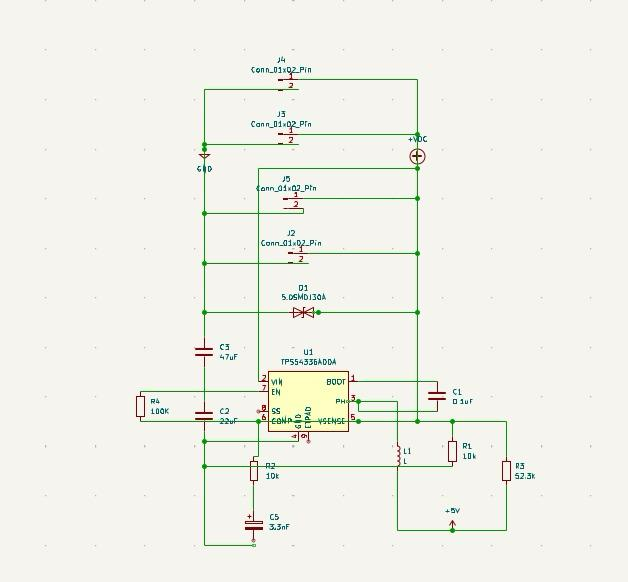
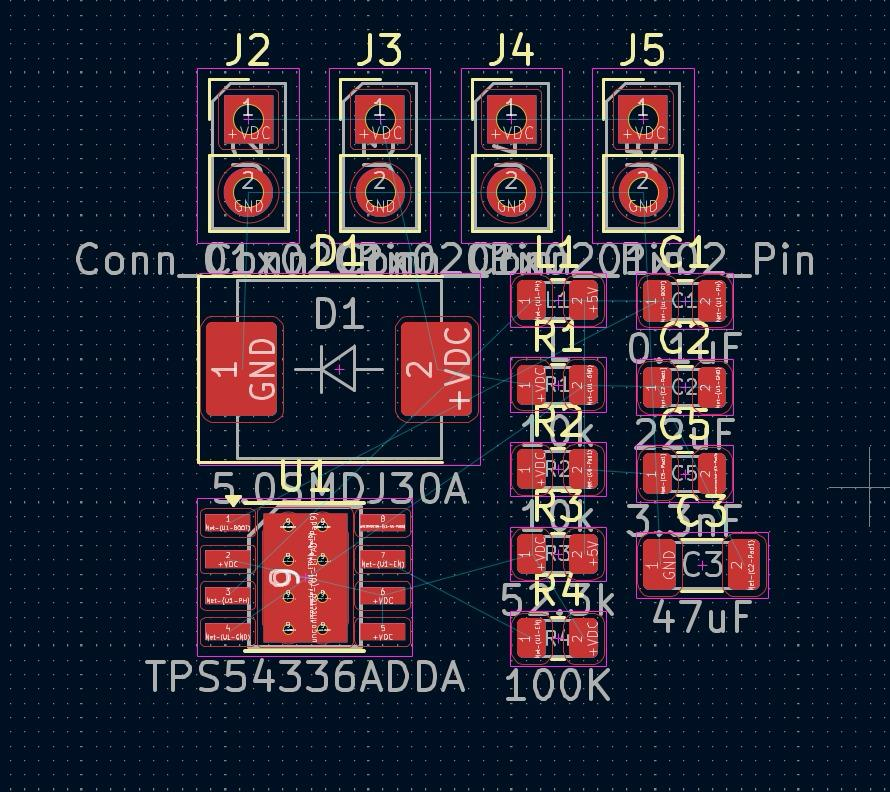
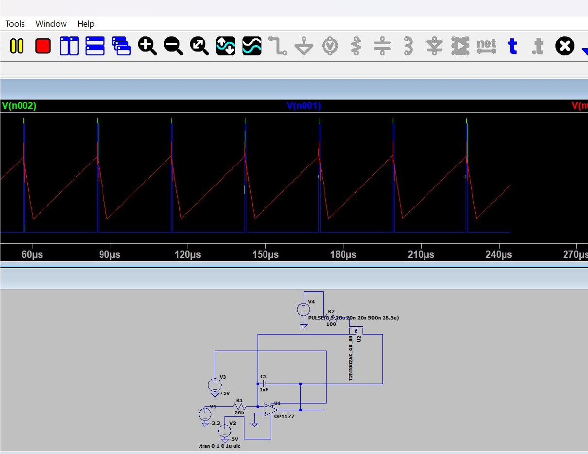

# Electronics Designs

A collection of circuit and PCB design work.

| Project | Tool | Summary |
|---|---|---|
| [TPS54336A 5 V buck converter](pcb-tps54336a-buck/) | KiCad | Schematic and PCB component placement for a 5 V step-down regulator |
| [Op-amp sawtooth generator](ltspice-sawtooth/) | LTspice | Transient simulation of an integrator-based ramp generator with periodic reset |

---

## TPS54336A 5 V buck converter

A synchronous step-down regulator based on the **TI TPS54336A**, taking a DC input and producing a regulated **+5 V** output.

**Design highlights**
- TPS54336A switching regulator (U1) with bootstrap capacitor C1 (0.1 µF)
- Feedback divider R1 (10 kΩ) / R3 (52.3 kΩ) sets the output to 5 V
- Compensation network R2 (10 kΩ) + C5 (3.3 nF)
- R4 (100 kΩ) on the EN pin
- Input bulk capacitance C3 (47 µF) and C2 (22 µF)
- **5.0SMDJ30A** TVS diode (D1) for input overvoltage and transient protection
- Four 2-pin connectors (J2–J5) for power in and out

| Schematic | PCB layout |
|---|---|
|  |  |

**Status:** schematic complete. The PCB view shows component placement with ratsnest connections; trace routing is the next step.

---

## Op-amp sawtooth generator (LTspice)

An integrator built around an **OP1177** op-amp (R1 = 28 kΩ, C1 = 1 nF) charges at a constant rate to produce a linear ramp. A switch driven by a pulse source (V4, period 28.5 µs) periodically discharges the capacitor, resetting the ramp and producing a sawtooth waveform.

Files: [`ltspice_sawtooth_simulation.pdf`](ltspice-sawtooth/ltspice_sawtooth_simulation.pdf)

---

## Author

**Vishnupriya Subramanian**
